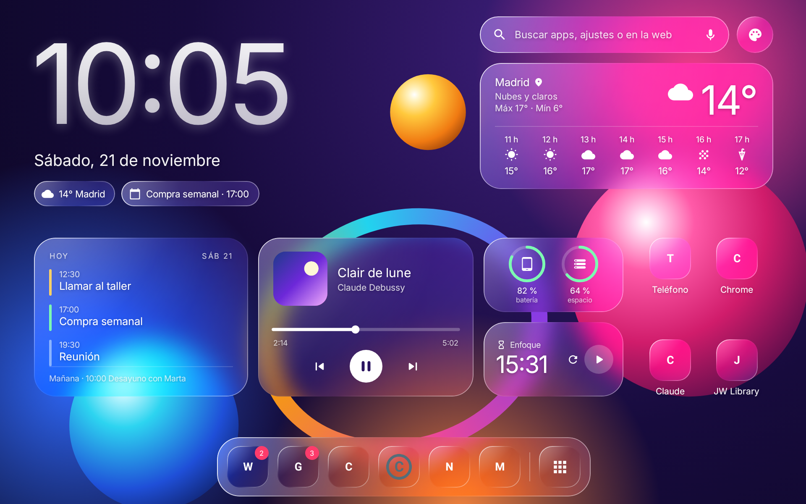
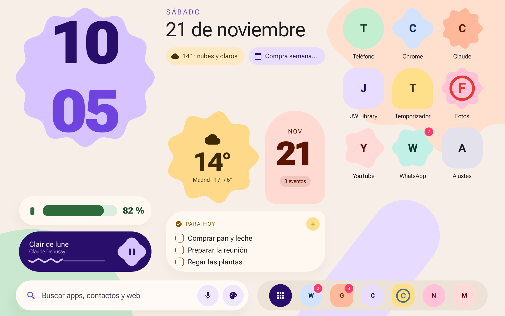
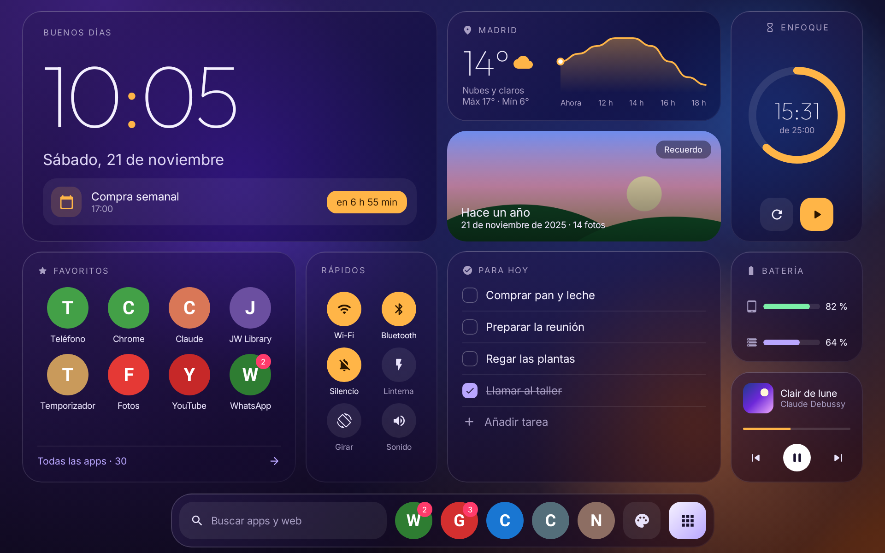
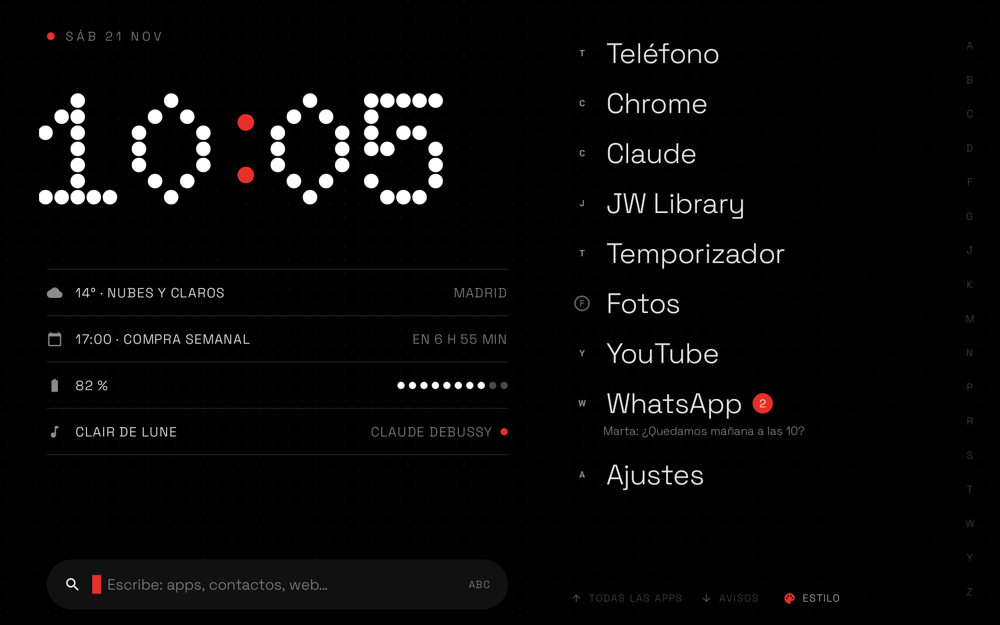

# Lanzador

Launcher (pantalla de inicio) para Android pensado para la tablet T65Max: 1920×1200 px, Android 14. Trae cuatro estilos y se cambia de uno a otro al momento. Funciona en horizontal y en vertical, en Android 10 o superior.

| Cristal | Expresivo |
| --- | --- |
|  |  |
| **Bento** | **Enfoque** |
|  |  |

Las capturas se generan con datos y apps de muestra; en la tablet salen tus apps, tus eventos y tu música.

## Estilos

- **Cristal**: widgets transparentes que desenfocan el fondo, al estilo Liquid Glass. Reloj grande, tiempo por horas, agenda, música, batería y espacio, temporizador, cuatro favoritos y dock flotante.
- **Expresivo**: Material 3 Expressive. Reloj dentro de una forma ondulada, tiempo en forma de sol, calendario en arco, tareas, barra de música ondulada y nueve favoritos con formas y colores pastel.
- **Bento**: bloques de cristal oscuro con acento ámbar. Reloj con cuenta atrás al próximo evento, gráfica de temperatura, temporizador circular, recuerdo de fotos de hace un año, favoritos, accesos rápidos, tareas, batería y música.
- **Enfoque**: negro, reloj de puntos, apps en lista de texto con contador de avisos y vista previa del último mensaje, índice A-Z que se mueve en onda.

Cada estilo cambia también el cajón de apps, los menús y los ajustes.

## Cambiar de estilo

- **Botón de paleta** en cada pantalla (junto al buscador en Cristal y Expresivo, en el dock en Bento, «Estilo» abajo en Enfoque), o **mantén pulsado** el fondo o cualquier widget: sale el selector con los cuatro estilos. Toca uno y cambia al momento.
- **Un estilo distinto cada día**: interruptor en el selector y en los ajustes. Van por turnos.
- Desde el selector, **Más ajustes** abre el panel completo: fondo (el del estilo, una foto tuya o el de Android), ciudad del tiempo, minutos del temporizador, permisos y apps ocultas.

## Gestos

| Gesto | Qué hace |
| --- | --- |
| Deslizar hacia arriba | Todas las apps (con etiquetas por categoría, frecuentes y búsqueda) |
| Deslizar hacia abajo | Notificaciones |
| Mantener pulsado el fondo o un widget | Selector de estilo |
| Mantener pulsada una app | Accesos directos, favoritos, dock, orden, información, ocultar, desinstalar |
| Tocar una tarea / mantenerla | Marcarla hecha / borrarla |
| Arrastrar por el índice A-Z | Saltar a esa letra (en Enfoque abre el cajón en esa letra) |

## Instalar

Hay dos APK en `apk/`, con la misma firma, así que se puede pasar de una a otra sin desinstalar:

| APK | Qué incluye | Play Protect |
| --- | --- | --- |
| `Lanzador.apk` (ligera, recomendada) | Todo menos la música que suena y los contadores de avisos | Se instala; como mucho avisa de que la app es desconocida |
| `Lanzador-completo.apk` | Todo, con lector de notificaciones | La bloquea al instalarla desde un archivo |

Play Protect bloquea por sistema las apps instaladas desde un navegador, una app de mensajería o un gestor de archivos si piden leer SMS, leer notificaciones o usar los servicios de accesibilidad. Es la «protección mejorada contra fraudes» que Google anunció el 7 de febrero de 2024 en su blog de seguridad. La versión completa necesita leer notificaciones para la música, por eso solo puede instalarse con Play Protect desactivado.

1. Abre `apk/Lanzador.apk` en la tablet y permite instalar desde esa app.
2. Si Play Protect avisa de que no reconoce la app, toca **Más detalles → Instalar de todos modos**.
3. Pulsa **Inicio** y elige **Lanzador** → **Siempre**. Si no pregunta: *Ajustes → Aplicaciones → Aplicaciones predeterminadas → Aplicación de pantalla de inicio*.

Todas las versiones se firman con la misma clave de depuración (`app/firma/debug.keystore`), que no protege nada y no sirve para Google Play.

## Permisos

Ninguno es obligatorio; cada widget explica qué le falta y tiene un botón para pedirlo.

| Permiso | Para qué |
| --- | --- |
| Calendario | Eventos de hoy y de mañana |
| Fotos | «Hace un año» en Bento |
| Acceso a notificaciones (solo versión completa) | Música que suena (con controles) y contadores de avisos |
| Notificaciones | Aviso cuando termina el temporizador |
| Internet | Tiempo de Open-Meteo |
| No molestar | Interruptor «Silencio» de Bento (Android pide confirmarlo aparte) |

En Android 13 y 14, el acceso a notificaciones de una app instalada desde un archivo aparece bloqueado al principio. Se desbloquea en *Información de la app → menú ⋮ → Permitir ajustes restringidos*.

## Compilar

Requisitos: JDK 17 o superior y el SDK de Android (plataforma 35).

```bash
echo "sdk.dir=/ruta/al/android-sdk" > local.properties
./gradlew :app:assembleLigeroRelease :app:assembleCompletoRelease   # APK en app/build/outputs/apk/
./gradlew :app:testCompletoDebugUnitTest                           # regenera docs/capturas (Robolectric + Roborazzi)
```

Las maquetas de diseño originales están en `conceptos/`.

## Estructura

| Carpeta / archivo | Contenido |
| --- | --- |
| `data/` | Apps e iconos (`AppRepository`), preferencias, tareas y temporizador (`LauncherPrefs`, `FocusTimer`), calendario, fotos y estado del dispositivo (`Sources`), música y avisos (`NotificationService`), tiempo (`WeatherClient`) |
| `ui/common/` | Fondos de cada estilo y cristal (`Wallpaper`, `Glass`), iconos y menú de app, índice A-Z, formatos de fecha y hora |
| `ui/styles/` | Una pantalla de inicio por estilo |
| `ui/AppDrawer.kt` | Cajón de apps que se adapta al estilo |
| `ui/Panels.kt` | Ajustes, selector de estilo y nueva tarea |

## Fuentes tipográficas

Inter, Outfit, Roboto Flex, Doto y Space Grotesk, todas con licencia SIL Open Font License 1.1 (https://openfontlicense.org), convertidas a TTF desde los paquetes de Fontsource.
