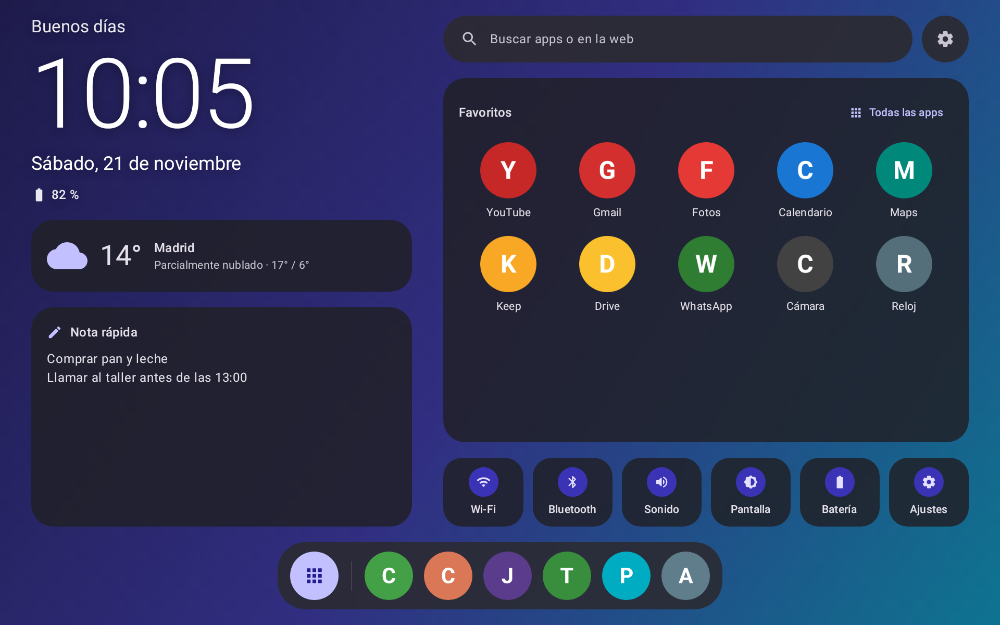

# Lanzador

Launcher (pantalla de inicio) para Android pensado para la tablet T65Max: 1920×1200 px, unos 1280×800 dp, Android 14. Funciona en horizontal y en vertical, y en cualquier tablet o móvil con Android 10 o superior.



## Qué hace

- **Inicio en dos columnas** (horizontal): a la izquierda reloj grande, fecha, batería, próxima alarma, tiempo y una nota rápida; a la derecha buscador, favoritos y accesos rápidos a Wi-Fi, Bluetooth, sonido, pantalla, batería y ajustes. Abajo, un dock con hasta 10 apps.
- **Cajón de apps** con índice A-Z lateral, sección «Frecuentes» (las que más abres desde el lanzador) y búsqueda que ignora tildes. Si ninguna app coincide, «Ir» busca en la web.
- **Menú de cada app** (mantener pulsada): accesos directos de la propia app (p. ej. nueva pestaña de incógnito en Chrome), añadir o quitar de favoritos y del dock, cambiar el orden, información de la app, ocultar y desinstalar.
- **Colores Material You**: toma la paleta del fondo de pantalla. El texto del escritorio pasa a oscuro si el fondo es claro.
- **Tiempo** de [Open-Meteo](https://open-meteo.com) (gratis, sin cuenta ni clave). Se elige la ciudad en los ajustes.
- **Gestos**: deslizar hacia arriba abre todas las apps; hacia abajo, las notificaciones; mantener pulsado el fondo abre los ajustes.
- Ajustes: tema (sistema, claro, oscuro), tamaño de iconos, mostrar u ocultar tiempo, nota y accesos rápidos, apps ocultas.
- Respeta el perfil de trabajo: sus apps salen con la insignia del maletín.

## Instalar en la tablet

1. Descarga `Lanzador.apk` en la tablet y ábrelo.
2. Android pedirá permiso para instalar apps desde la app con la que lo abriste (Chrome, Archivos o Claude). Actívalo y pulsa **Instalar**.
3. Pulsa el botón **Inicio**. Aparecerá la pregunta de qué pantalla de inicio usar: elige **Lanzador** y **Siempre**.
   Si no aparece: *Ajustes → Aplicaciones → Aplicaciones predeterminadas → Aplicación de pantalla de inicio → Lanzador*. También hay un atajo en los ajustes del lanzador.

Para volver al launcher original, en ese mismo menú elige el anterior.

Las versiones nuevas se instalan encima de la anterior sin perder favoritos ni ajustes, porque todas se firman con la misma clave (`app/firma/debug.keystore`). Esa clave es de depuración, no protege nada y no sirve para publicar en Google Play.

## Compilar

Requisitos: JDK 17 o superior y el SDK de Android (plataforma 35).

```bash
echo "sdk.dir=/ruta/al/android-sdk" > local.properties
./gradlew :app:assembleRelease        # APK en app/build/outputs/apk/release/
./gradlew :app:testDebugUnitTest      # regenera las capturas de docs/capturas
```

Las capturas se dibujan con Robolectric y Roborazzi a 1920×1200 px, sin emulador, con apps y fondo de muestra.

## Estructura

| Archivo | Contenido |
| --- | --- |
| `data/AppRepository.kt` | Lista de apps con `LauncherApps`, iconos, accesos directos, avisos de instalación y desinstalación |
| `data/LauncherPrefs.kt` | Favoritos, dock, ocultas, uso, nota y ajustes en `SharedPreferences` |
| `data/WeatherClient.kt` | Búsqueda de ciudad y tiempo actual en Open-Meteo |
| `LauncherViewModel.kt` | Batería, alarma, colores del fondo, tiempo |
| `DeviceActions.kt` | Abrir apps, paneles de ajustes, notificaciones, desinstalar |
| `ui/LauncherScreen.kt` | Distribución horizontal y vertical, gestos, capas |
| `ui/AppDrawer.kt` | Cajón, búsqueda e índice A-Z |
| `ui/SettingsPanel.kt` | Panel lateral de ajustes |

## Permisos

| Permiso | Para qué |
| --- | --- |
| `INTERNET` | Tiempo |
| `EXPAND_STATUS_BAR` | Abrir las notificaciones al deslizar hacia abajo |
| `REQUEST_DELETE_PACKAGES` | Opción «Desinstalar» del menú de cada app |

No pide ubicación, contactos ni almacenamiento.
